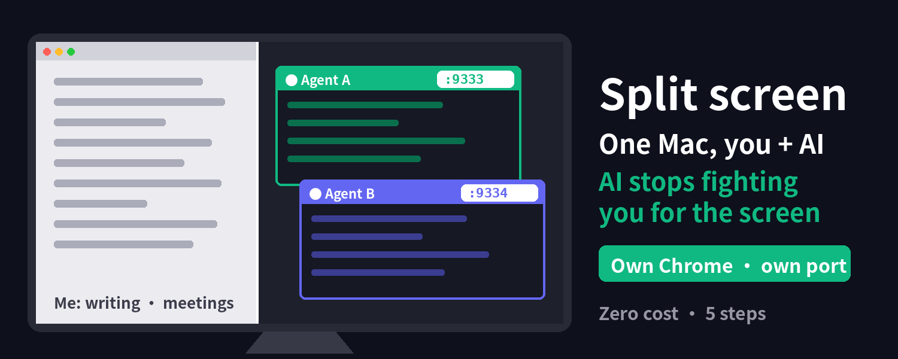

# agent-chrome-split

**Give each AI agent its own Chrome, so you and your agents can share one computer without fighting over the screen.**

[中文说明](README.zh-CN.md) · [Instructions for AI agents](AGENTS.md)



## The problem

When an AI agent drives your browser, it fights you for the same screen: you move the mouse and it clicks the wrong thing; it reloads and your page is gone.

## The idea (zero cost)

You keep working as usual. Each agent works in **its own, separate Chrome instance** with its own profile folder and its own debug port. It drives that browser through the Chrome DevTools Protocol (CDP), so it never needs your mouse, keyboard or the foreground window.

## 5 steps

1. **Give the agent its own Chrome** (separate profile folder + port, fully apart from your own browser):

   ```bash
   open -na "Google Chrome" --args --user-data-dir=$HOME/AgentChrome --remote-debugging-port=9333
   ```

   Or use the script, which also sets downloads and a label tab:

   ```bash
   chmod +x scripts/*.sh   # or run with: bash scripts/...
   NAME=agent-a PORT=9333 COLOR="#10b981" scripts/launch-agent-chrome.sh
   scripts/make-launcher.sh agent-a 9333 "#10b981"   # macOS: double-clickable Desktop launcher
   ```

2. **Log in once by hand** to the sites the agent needs. The session stays in that profile.
3. **The agent sends commands through the debug port** (`http://127.0.0.1:9333`), not through your mouse. You use yours, it runs its own.
4. **Multiple agents → one Chrome each**: one profile, one port (9333, 9334, 9335…), and a **colored label tab** with its name so you can tell windows apart at a glance (`scripts/label-tab.sh`). See [`examples/`](examples/).
5. **Humans step in only at key points**: the agent works up to the last step, stops, and leaves the result in its window. You look, decide, then it continues.

## Downloads: one folder per agent

Give every agent its own download folder so files never mix and Chrome never pops a "Save as" dialog:

- At launch, `launch-agent-chrome.sh` writes `download.default_directory`, `prompt_for_download: false` and `directory_upgrade: true` into the profile (only while that Chrome is not running).
- For a running instance: `python3 scripts/set-download-dir.py 9333 ~/Downloads/agent-a` (uses CDP `Browser.setDownloadBehavior`).
- Or set it by hand in that Chrome: Settings → Downloads.

## Cloud agents

Local agents connect to `127.0.0.1:<port>` directly. Cloud agents can't, because the debug port only listens locally by default, and that is on purpose. Use an SSH tunnel over a private network instead of exposing the port: see [docs/ssh-tunnel.md](docs/ssh-tunnel.md).

```bash
ssh -N -L 9335:127.0.0.1:9335 <user>@<private-host>
```

Otherwise, fall back to letting the agent use its window in the foreground.

## Safety notes

- **The debug port = full control** of every logged-in session in that profile. Treat it like a password.
- **Never** bind it to `0.0.0.0` or the public internet (`--remote-debugging-address` stays unset).
- **Never commit** profiles, cookies, `Preferences` or downloads (see `.gitignore`).
- Agents should only touch **their own port**, never your everyday browser.
- A **human approves anything consequential** (sending, posting, buying, deleting).
- Keep the computer from sleeping (a screensaver is fine).

## Related work & credit

Inspired by community discussion on running agents side by side with humans. Related: <https://x.com/turingou/status/2109854210917593557>

Background article (Chinese): <https://x.com/ImmunoSparkle/status/2110193604908003442>

## License

MIT © Lumina Research
